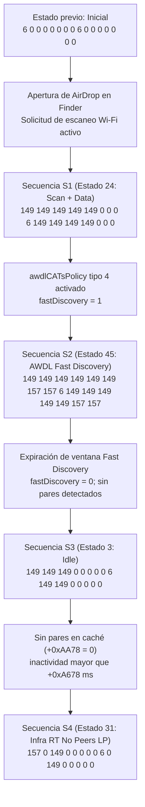

# Explicación de las secuencias AWDL observadas en hardware real (macOS 26.7.1, 25G241)

Análisis del kernelcollection de macOS 26.7.1 (build 25G241, Darwin 25.6.0, `x86_64`) que determina
el estado del gestor AWDL (`IO80211AWDLPeerManager`), la fila de la tabla de tipos de ranura
`__ZL20_channelSeqSlotTypes` y las condiciones operativas que producen las cuatro secuencias de canales
(petición `APPLE80211_IOC_AWDL_SYNC_CHANNEL_SEQUENCE`, tipo 129, 16 ranuras) registradas en hardware
real tras la apertura de la ventana de AirDrop en Finder. Complementa `Docs/AWDL_SECUENCIA_CON_INFRA.md`,
`Docs/AWDL_CHANNEL_SEQUENCE_CONTROL.md` y `Docs/AWDL_CAP29_DOBLE_BANDA_RIESGOS.md`.

Fuente: desmontaje y descompilación en kernelcache anotado de la compilación 25G241. Todas las
direcciones virtuales (VA) citadas corresponden a cabeceras de instrucción o datos estáticos de esa
imagen. Las referencias de ivars del gestor se toman respecto de `*(this+0x20)` (`awdlIvars`) y las del
objeto base respecto de `*(this+0x18)` (`pm`). Lo no verificado se marca `?`.

---

## 1. Resumen

En las pruebas en hardware real con la capacidad 29 (doble banda) activa, la interfaz de infraestructura
asociada en 5 GHz (canal primario 157, 80 MHz, bloque 149–161, flags `0x410`), canales sociales
6/149/44, sin pares AWDL y sin sumidero AirPlay (`airplaySink == 0`), la apertura de AirDrop generó
en orden cuatro secuencias de canales:

1. **S1**: `149 149 149 149 149   0   0   0   6 149 149 149 149   0   0   0`  
   Producida por el estado **24 (`Scan + Data`)**, fila `0xffffff80023aa7f0` (`3 3 3 3 3 1 1 1 2 4 3 4 4 1 1 1`).
   Se activa mientras hay un escaneo en curso (`pm+0x9A8 != 0`); quién pide ese escaneo al abrir AirDrop
   no se siguió `?`.
2. **S2**: `149 149 149 149 149 149 157 157   6 149 149 149 149 149 157 157`  
   Producida por el estado **45 (`AWDL Fast Discovery`)**, fila `0xffffff80023aad30` (`3 3 3 3 3 3 9 9 2 4 3 4 4 4 9 9`).
   Las ranuras 6, 7, 14 y 15 corresponden al **tipo 9** (no al tipo 7), el cual resuelve al canal de
   infraestructura 157 mediante `infraAllowedForNonRealtimeCases()` sin requerir servicios AirPlay.
   Se activa con `awdlCATsPolicy` tipo de notificación 4 activado (descubrimiento rápido); que la
   petición venga de `wifip2pd` no se verificó `?`.
3. **S3**: `149 149 149   0   0   0   0   0   6 149 149   0   0   0   0   0`  
   Producida por el estado **3 (`Idle`)** (o alternativamente estado **1 `Discovery + Infra Stream`**),
   fila `0xffffff80023aa2b0` (`3 3 3 1 1 1 7 7 2 4 3 1 1 1 7 7`).
   Las ranuras 6, 7, 14 y 15 son de **tipo 7**, que evalúan `addInfraToMinimumChannelSequence()`; al no existir
   servicios AirPlay registrados (`_countAirPlayServices == 0`), resuelven a canal 0.
4. **S4**: `157   0 149   0   0   0   0   0   6   0 149   0   0   0   0   0`  
   Producida por el estado **31 (`Infra BE RealTime + No Cached Peers + LP`)**, fila `0xffffff80023aa9b0`
   (`9 1 3 1 1 1 1 1 2 1 3 1 1 1 1 1`).
   La ranura 0 es de tipo 9 (resolviendo al canal 157), las ranuras 2 y 10 son de tipo 3 (social 149),
   la 8 es de tipo 2 (social 6) y las 12 restantes son de tipo 1 (canal 0). Indica que el gestor AWDL
   entra en reposo de bajo consumo (*Low Power Idle*) al agotarse la ventana de descubrimiento sin hallar pares.

Las ranuras 4 y 12 no resuelven a 149 por ninguna sustitución dinámica sobre el tipo 1: en S1 y S2 esas
ranuras están tabuladas estáticamente como **tipo 3** y **tipo 4**, las cuales cargan de forma directa el
canal secundario y actual (149).

---

## 2. Tabla completa de tipos de ranura por estado (`__ZL20_channelSeqSlotTypes`)

La tabla estática reside en la dirección `0xffffff80023aa1f0` y contiene 56 filas (estados 0 a 55),
cada una compuesta por 16 enteros de 32 bits (64 bytes por fila). El cálculo de dirección de una fila
se ejecuta en `IO80211AWDLPeerManager::setChannelSequenceByState` mediante `shl rax, 6` en
`0xffffff80021f545c`, seguido del acceso indexado `lea rcx, __ZL20_channelSeqSlotTypes` en
`0xffffff80021f5475`. Los nombres literales de estado se resuelven a través del arreglo de punteros
a cadena en `0xffffff8002459c20`. Inmediatamente tras la fila 55 (offset `+0xE00`), en `0xffffff80023aaff0`,
comienza la estructura de datos `__ZL13_channel6Info`.

| Estado | Nombre en `0xffffff8002459c20` | VA de la fila | Ranuras 0..15 (tipo de ranura) |
|:---:|:---|:---:|:---|
| 0 | Discovery | `0xffffff80023aa1f0` | ` 3  3  3  3  1  1  7  7  2  4  3  4  1  1  7  7` |
| 1 | Discovery + Infra Stream | `0xffffff80023aa230` | ` 3  3  3  1  1  1  7  7  2  4  3  1  1  1  7  7` |
| 2 | Assisted Discovery | `0xffffff80023aa270` | `10 10 10 10 10 10 11 11 10 10 10 10 10 10 11 11` |
| 3 | Idle | `0xffffff80023aa2b0` | ` 3  3  3  1  1  1  7  7  2  4  3  1  1  1  7  7` |
| 4 | Low Power | `0xffffff80023aa2f0` | ` 9  1  3  1  1  1  7  7  2  7  3  1  1  1  7  7` |
| 5 | Data | `0xffffff80023aa330` | ` 0  0  0  0  0  0  0  0  0  0  0  0  0  0  0  0` |
| 6 | Data + Infra Stream | `0xffffff80023aa370` | ` 3  3  3  3  9  9  6  6  2  4  3  9  9  9  9  9` |
| 7 | Data + Infra Data | `0xffffff80023aa3b0` | ` 3  3  3  3  9  9  6  6  2  4  3  4  9  9  9  9` |
| 8 | Data + Infra Idle | `0xffffff80023aa3f0` | ` 3  3  3  3  3  3  6  6  2  4  3  4  4  4  6  6` |
| 9 | RealTimeData | `0xffffff80023aa430` | ` 0  0  0  0  0  0  0  0  0  0  0  0  0  0  0  0` |
| 10 | RealTimeData + InfraAssist | `0xffffff80023aa470` | ` 9  9  9  9  9  9  9  9  9  9  9  9  9  9  9  9` |
| 11 | RealTimeData + InfraAssist with Social | `0xffffff80023aa4b0` | ` 9  9  3  9  9  9  9  9  9  9  4  9  9  9  9  9` |
| 12 | RealTimeData + Split Infra Legacy | `0xffffff80023aa4f0` | `12 12 12 12  5  5  5  5 12 12 12 12  6  6  6  6` |
| 13 | RealTimeData + Split Infra | `0xffffff80023aa530` | `12 12 12 12  5  5  6  6 12 12 12 12  5  5  6  6` |
| 14 | RealTimeData + Split Infra + Same DFS | `0xffffff80023aa570` | `12  5  5  5  5  5  5  5  5 12  5  5  5  5  5  5` |
| 15 | RealTimeData + Split Infra + Retrogade Legacy | `0xffffff80023aa5b0` | `12 12 12 12  5  5  5  5 12 12 12 12 12 12  1  1` |
| 16 | RealTimeData + Split Infra + Retrogade | `0xffffff80023aa5f0` | `12 12 12 12  5  5  1  1 12 12 12 12 12 12  1  1` |
| 17 | RealTimeData + Split Infra + RetroSDB Legacy | `0xffffff80023aa630` | `12 12 12 12  5  5  5  5 12 12 12 12 12 12  2  2` |
| 18 | RealTimeData + Split Infra + RetroSDB | `0xffffff80023aa670` | `12 12 12 12  5  5  2  2 12 12 12 12 12 12  2  2` |
| 19 | RealTimeData + Favor ATV Infra | `0xffffff80023aa6b0` | ` 5  5 12  5  5  5  5  5  5  5 12  5  5  5  6  6` |
| 20 | RealTimeData + Favor Client Infra Legacy | `0xffffff80023aa6f0` | ` 5  5 12  5  5  5  5  5  5  5 12  5  5  5  6  6` |
| 21 | RealTimeData + Favor Client Infra | `0xffffff80023aa730` | ` 5  5 12  5  5  5  6  6  5  5 12  5  5  5  6  6` |
| 22 | unknown | `0xffffff80023aa770` | ` 3  3  5  5  5  5  5  5  5 12 12  5  5  5  6  6` |
| 23 | IdleAndRealTimeData | `0xffffff80023aa7b0` | ` 3  3  3  1  1  1  8  8  2  4  4  1  1  1  8  8` |
| 24 | Scan + Data | `0xffffff80023aa7f0` | ` 3  3  3  3  3  1  1  1  2  4  3  4  4  1  1  1` |
| 25 | Scan + Data + Infra Data | `0xffffff80023aa830` | ` 3  3  3  9  9  1  1  1  2  4  3  9  9  1  1  1` |
| 26 | Scan + RealtimeData | `0xffffff80023aa870` | `12 12 12 12  5  1  1  1 12 12 12 12  6  1  1  1` |
| 27 | Scan + RealtimeData + InfraAssist | `0xffffff80023aa8b0` | ` 9  9  9  9  5  1  1  1  9  9  9  9  6  1  1  1` |
| 28 | Piggyback Scan + Data | `0xffffff80023aa8f0` | ` 0  0  0  0  0  0  0  0  0  0  0  0  0  0  0  0` |
| 29 | Infra Priority | `0xffffff80023aa930` | ` 9  9  3  1  1  1  1  9  2  9  3  9  1  1  1  9` |
| 30 | Infra BE RealTime + No Cached Peers + Disc | `0xffffff80023aa970` | ` 9  1  3  1  1  3  9  9  2  1  3  1  1  3  9  9` |
| 31 | Infra BE RealTime + No Cached Peers + LP | `0xffffff80023aa9b0` | ` 9  1  3  1  1  1  1  1  2  1  3  1  1  1  1  1` |
| 32 | Forced | `0xffffff80023aa9f0` | ` 0  0  0  0  0  0  0  0  0  0  0  0  0  0  0  0` |
| 33 | Assisted Discovery Multi Channel | `0xffffff80023aaa30` | `10 10 10 10 10 10 11 11 13 13 13 13 13 13 14 14` |
| 34 | Time Sync | `0xffffff80023aaa70` | ` 3  1  3  1  3  1  1  1  3  1  3  1  3  1  1  1` |
| 35 | unknown | `0xffffff80023aaab0` | ` 3  3  3  3  3  3  1  1  3  3  3  3  3  3  1  1` |
| 36 | Time Sync Infra | `0xffffff80023aaaf0` | `15  1  3  1 15  1  1  1 15  1  3  1 15  1  1  1` |
| 37 | unknown | `0xffffff80023aab30` | `15  3  3  3  3  3  1  1  3  3  3  3  3  3  1  1` |
| 38 | Time Sync Retro | `0xffffff80023aab70` | ` 3  1  1  1  3  1  1  1  3  1  1  1  3  1  1  1` |
| 39 | Sidecar Start | `0xffffff80023aabb0` | ` 0  0  0  0  0  0  0  0  0  0  0  0  0  0  0  0` |
| 40 | RtMode Start | `0xffffff80023aabf0` | ` 0  0  0  0  0  0  0  0  0  0  0  0  0  0  0  0` |
| 41 | High Thruput | `0xffffff80023aac30` | ` 4  4  4  4  4  4  4  4  4  4  4  4  4  4  4  4` |
| 42 | Sidecar Single 2.4Channel | `0xffffff80023aac70` | `12 12 12 12  5  5  5  5 12 12 12 12 12 12 12 12` |
| 43 | Ranging | `0xffffff80023aacb0` | ` 4  4  4  4  5  5  5  5  4  4  4  4  5  5  5  5` |
| 44 | RealTimeGroup | `0xffffff80023aacf0` | ` 0  0  0  0  0  0  0  0  0  0  0  0  0  0  0  0` |
| 45 | AWDL Fast Discovery | `0xffffff80023aad30` | ` 3  3  3  3  3  3  9  9  2  4  3  4  4  4  9  9` |
| 46 | ProMode + Infra Idle | `0xffffff80023aad70` | `16 16  3 16 16 16 17 17 16 16  4 16 16 16 17 17` |
| 47 | AWDL Fast Discovery and infra priority | `0xffffff80023aadb0` | ` 3  9  9  3  9  9  3  9  2  3  9  9  3  9  9  9` |
| 48 | AWDL Fast Discovery and infra priority | `0xffffff80023aadf0` | ` 9  9  3  9  9  3  9  9  2  9  3  9  9  3  9  9` |
| 49 | ProMode Scan + Data | `0xffffff80023aae30` | `16 16  3 16 16  1  1  1 16 16  4 16 16  1  1  1` |
| 50 | ProMode Scan + Data + Infra Data | `0xffffff80023aae70` | `16 16  3 19 19  1  1  1 16 16  4 19 19  1  1  1` |
| 51 | ProMode + Infra Stream | `0xffffff80023aaeb0` | `16 16  3 16 19 19 17 17 16 16  4 19 19 19 19 19` |
| 52 | ProMode + Infra Data | `0xffffff80023aaef0` | `16 16  3 16 19 19 17 17 16 16  4 16 19 19 19 19` |
| 53 | Long Discovery | `0xffffff80023aaf30` | ` 3  3  3  3  3  3  7  7  2  4  3  4  3  3  7  7` |
| 54 | Ultra Low Latency Infra | `0xffffff80023aaf70` | `20  9 20  1  1  1  1  9 20 20 20 20  1  1  1  9` |
| 55 | RTG AirDrop | `0xffffff80023aafb0` | ` 0  0  0  0  0  0  0  0  0  0  0  0  0  0  0  0` |

---

## 3. Identificación exacta de las secuencias observadas S1–S4

| Secuencia | Secuencia de canales observada | Estado asignado | Fila tabulada | Condiciones operativas | VAs clave |
|---|---|:---:|---|---|---|
| **S1** | `149 149 149 149 149 0 0 0 6 149 149 149 149 0 0 0` | **24** (`Scan + Data`) | `3 3 3 3 3 1 1 1 2 4 3 4 4 1 1 1` | Escaneo activo (`pm+2472 != 0`); sin ProMode (`+65432 == 0`). Tipos 3 y 4 resuelven a 149; tipo 2 a 6; tipo 1 a canal 0. | `0xffffff80022198bc` `0xffffff80022198c5` `0xffffff80023aa7f0` `0xffffff80021f549a` |
| **S2** | `149 149 149 149 149 149 157 157 6 149 149 149 149 149 157 157` | **45** (`AWDL Fast Discovery`) | `3 3 3 3 3 3 9 9 2 4 3 4 4 4 9 9` | `fastDiscovery == 1` (`+65193`); `infraAllowedForNonRealtimeCases()` cierto; tipo 9 resuelve a infra 157 sin requerir servicios AirPlay. | `0xffffff80021ff051` `0xffffff80021ff073` `0xffffff80021d456b` `0xffffff80023aad30` `0xffffff80021f568e` |
| **S3** | `149 149 149 0 0 0 0 0 6 149 149 0 0 0 0 0` | **3** (`Idle`) o **1** (`Disc+Infra`) | `3 3 3 1 1 1 7 7 2 4 3 1 1 1 7 7` | Cese de Fast Discovery (`+65193 = 0`); sin pares AWDL; sin servicios AirPlay (`_countAirPlayServices == 0`); tipo 7 evalúa falso y cae a canal 0. | `0xffffff80021f1bb6` `0xffffff80023aa2b0` `0xffffff80021f56ed` `0xffffff80021f5ef6` |
| **S4** | `157 0 149 0 0 0 0 0 6 0 149 0 0 0 0 0` | **31** (`Infra BE RT + No Cached Peers + LP`) | `9 1 3 1 1 1 1 1 2 1 3 1 1 1 1 1` | `+0x3ED0 == 1`; sin pares en caché (`+0xAA78 == 0`); sin actividad durante `+0xA678` ms (umbral contra `+0xA5E8` y `+0xA5D8`); ranura 0 (tipo 9) resuelve a infra 157; ranuras 2 y 10 a 149; 8 a 6; resto a 0. | `0xffffff80021d4504` `0xffffff80023aa9b0` `0xffffff80021f568e` `0xffffff80021f549a` |

---

## 4. Resolución de tipos de ranura a canal (`0..20`)

La función `IO80211AWDLPeerManager::setChannelSequenceByState` (`0xffffff80021f53aa`) implementa un
bucle de 16 iteraciones (`rbx` avanza en pasos de 12 bytes desde `0` hasta `0xC0`, `0xffffff80021f5464`
a `0xffffff80021f5bf0`). En cada iteración carga el tipo dword desde la tabla (`0xffffff80021f547c`)
y salta por una tabla indirecta de 21 entradas (`0xffffff80021f5e90`, salto en `0xffffff80021f5498`).
Al final de cada ranura se ejecuta una guardia de 6 GHz (`0xffffff80021f5b82`) que sustituye el canal
si no está autorizado.

A continuación se detalla la resolución de cada tipo (0..20) con sus campos de procedencia y puertas:

### Tipo 0: No modificar ranura
- **VA**: `0xffffff80021f5b7e`
- **Fuente**: No realiza escritura sobre `awdlIvars + 0xA774 + slot*12`. Conserva verbatim el valor previo.
- **Uso**: Estados que preservan secuencias aprendidas o fijadas externamente (estados 5, 9, 28, 32, 39, 40, 44, 55).

### Tipo 1: Ranura no servida (canal 0)
- **VA**: `0xffffff80021f549a`
- **Fuente**: Escribe `dword_FFFFFF8002488A90` (valor 0) en `+0xA77C` (`0xffffff80021f54a4`) y copia la constante
  `__ZL13_zeroChanInfo` (`0xffffff8002488a88` = `{version: 1, channel: 0}`) en `+0xA774` (`0xffffff80021f54ab`,
  almacén en `0xffffff80021f5b76`).
- **Comportamiento**: Resuelve **siempre e incondicionalmente a canal 0**. No existe ninguna ruta en el
  desensamblado que reemplace el canal de una ranura de tipo 1 por un canal social o de infraestructura.
- **Aclaración sobre S1 y S2**: La presencia de canal 149 en las ranuras 4 y 12 en las secuencias S1 y S2 no se
  debe a una sustitución del tipo 1, sino a que en los estados 24 y 45 dichas ranuras **no son de tipo 1**:
  en el estado 24 la ranura 4 es **tipo 3** y la ranura 12 es **tipo 4**; en el estado 45 la ranura 4 es **tipo 3**
  y la 12 es **tipo 4**.

### Tipo 2: Info maestra primaria (canal social primario)
- **VA**: `0xffffff80021f5b5e`
- **Fuente**: Lee flags desde `awdlIvars + 0x42A8` (`0xffffff80021f5b62`) y `{version, channel}` desde
  `awdlIvars + 0x42A0` (`0xffffff80021f5b6f`).
- **Resultado en el escenario**: `{1, 6, 0x8}` (canal 6, 2.4 GHz a 20 MHz).

### Tipo 3: Info maestra secundaria o primaria
- **VA**: `0xffffff80021f56e4` (salto a `0xffffff80021f58d2`)
- **Fuente**: Comprueba `awdlIvars + 0x42B0` (canal secundario) en `0xffffff80021f58d2`.
  - Si `+0x42B0 != 0`: toma `{version, channel}` de `awdlIvars + 0x42AC` y flags de `+0x42B4` (`0xffffff80021f58df`).
  - Si `+0x42B0 == 0`: retrocede a la maestra primaria `awdlIvars + 0x42A0` (`0xffffff80021f5a4e`).
- **Resultado en el escenario**: Con capacidad 29 activa, `+0x42B0 == 149`, por lo que resuelve a `{1, 149, 0x10}`.

### Tipo 4: Canal AWDL actual
- **VA**: `0xffffff80021f5654`
- **Fuente**: Lee flags desde `awdlIvars + 0x1A8` (`0xffffff80021f5658`) y `{version, channel}` desde
  `awdlIvars + 0x1A0` (`0xffffff80021f5665`).
- **Resultado en el escenario**: Inicializado por `selectChannelsToUseForAWDL` (`0xffffff80021dc2f2`) con el valor
  de la secundaria `{1, 149, 0x10}`.

### Tipo 5: Canal de tiempo real / par RT
- **VA**: `0xffffff80021f5785`
- **Fuente**: Lee flags desde `awdlIvars + 0x42C0` (`0xffffff80021f5789`) y `{version, channel}` desde
  `awdlIvars + 0x42B8` (`0xffffff80021f5796`).

### Tipo 6: Canal auxiliar / DFS secundario
- **VA**: `0xffffff80021f588f`
- **Fuente**: Lee flags desde `awdlIvars + 0x42CC` (`0xffffff80021f5893`) y `{version, channel}` desde
  `awdlIvars + 0x42C4` (`0xffffff80021f58a0`).

### Tipo 7: Infraestructura con gate de AirPlay
- **VA**: `0xffffff80021f56ed`
- **Fuente**: Invoca `IO80211AWDLPeerManager::addInfraToMinimumChannelSequence` en `0xffffff80021f56f0`.
  - Si devuelve `true`: carga `{version, channel}` desde `pm + 0x9BC` (`pm + 2492`) y flags desde `pm + 0x9C4`
    (`pm + 2500`) en `0xffffff80021f5707`–`0xffffff80021f571b`.
  - Si devuelve `false`: carga `__ZL13_zeroChanInfo` y `dword_FFFFFF8002488A90` (canal 0) en `0xffffff80021f56f5`.
- **Condición interna de `addInfraToMinimumChannelSequence`** (`0xffffff80021f5ef6`):
  Exige la conjunción de:
  1. `infraAllowedForNonRealtimeCases()` != 0 (`0xffffff80021f5f57`).
  2. Flags de infra sin bit `0x2000` (no 6 GHz) en `0xffffff80021f5f4d`.
  3. **Recuento de servicios AirPlay > 0**: `IO80211CommandQueue::lockMap` con callback `_countAirPlayServices`
     (`0xffffff80021f5f1e`). Sin servicios `"airplay"`/`"raop"`, devuelve 0 incondicionalmente.

### Tipo 8: Infraestructura con gate de AirPlay Sink
- **VA**: `0xffffff80021f592c`
- **Fuente**: Comprueba `awdlIvars + 0xA648` (`airplaySink`) en `0xffffff80021f5930`.
  - Si `+0xA648 != 0`: copia canal y flags de infra desde `pm + 0x9BC`/`0x9C4` (`0xffffff80021f5947`).
  - Si `+0xA648 == 0`: escribe canal 0 (`_zeroChanInfo`, `0xffffff80021f5937`).

### Tipo 9: Infraestructura permitida sin gate de servicios AirPlay
- **VA**: `0xffffff80021f568e`
- **Fuente**: Invoca `IO80211AWDLPeerManager::infraAllowedForNonRealtimeCases` en `0xffffff80021f5691`.
  - **Rama positiva** (`0xffffff80021f569e`): Copia **directamente** `{version, channel}` desde `pm + 0x9BC`
    (`0xffffff80021f56a6`) y flags desde `pm + 0x9C4` (`0xffffff80021f56ad`). **No consulta AirPlay**.
    En el escenario con infra asociada en 157 (`0x410`), no-DFS, esta condición es verdadera y escribe
    `{1, 157, 0x410}`.
  - **Rama negativa** (`0xffffff80021f5a5a`):
    - Si es la **ranura 0** (`rbx == 0`, `0xffffff80021f5a61`): evalúa `awdlIvars + 0x3ED9` (infra permitida) en
      `0xffffff80021f5dc8`. Si está activo y `pm + 0x9BC != 0`, **copia igualmente el canal de infraestructura**
      en `0xffffff80021f5e75`; si no, escribe canal 6 con flags `0xA` en `0xffffff80021f5df5`.
    - Si son las **ranuras 1..15** (`rbx != 0`): evalúa si `fastDiscovery` (`awdlIvars + 0xFEA9`), el estado y SDB
      están activos (`0xffffff80021f5a67`–`0xffffff80021f5a9f`); si lo están, escribe canal 6; si no, escribe canal 0.

### Tipo 10: Descubrimiento asistido primario
- **VA**: `0xffffff80021f58eb`
- **Fuente**: Canal asistido `awdlIvars + 0xFA0C`/`+0xFA08` (`0xffffff80021f58f4`). Si es 0, retrocede a
  secundaria `+0x42AC` o primaria `+0x42A0` (`0xffffff80021f58fd`–`0xffffff80021f590b`).

### Tipo 11: Descubrimiento asistido secundario
- **VA**: `0xffffff80021f559c`
- **Fuente**: Evalúa marcas de tiempo `awdlIvars + 0xFA28` y `+0xFA30` contra `mach_absolute_time()` (ventana de
  1000 ms, `0xffffff80021f55de`, `0xffffff80021f5624`). Selecciona canal asistido `+0xFA08` o canal de infra
  `pm + 0x9BC` (`0xffffff80021f5641`, `0xffffff80021f5da4`).

### Tipo 12: Canal RT Legacy
- **VA**: `0xffffff80021f5671`
- **Fuente**: Flags desde `awdlIvars + 0x1C0` (`0xffffff80021f5675`) y canal desde `awdlIvars + 0x1B8` (`0xffffff80021f5682`).

### Tipo 13: Descubrimiento asistido multicanal primario
- **VA**: `0xffffff80021f57c9`
- **Fuente**: Estructura `awdlIvars + 0xFA08` o secundario/primario con soporte de par (`0xffffff80021f57ee`–`0xffffff80021f583e`).

### Tipo 14: Descubrimiento asistido multicanal secundario
- **VA**: `0xffffff80021f54e5`
- **Fuente**: Estructura `awdlIvars + 0xFA14` o temporizadores en `+0xFA28`/`+0xFA30` (`0xffffff80021f5519`–`0xffffff80021f5584`).

### Tipo 15: Canal RT alternativo
- **VA**: `0xffffff80021f56c7`
- **Fuente**: Flags desde `awdlIvars + 0x1CC` (`0xffffff80021f56cb`) y canal desde `awdlIvars + 0x1C4` (`0xffffff80021f56d8`).

### Tipo 16: Canal ProMode
- **VA**: `0xffffff80021f54b7`
- **Fuente**: Comprueba `awdlIvars + 0xFF80` (`0xffffff80021f54bb`). Si activo, lee `+0xFF7C`/`+0xFF84`
  (`0xffffff80021f54d0`); si no, lee canal actual `+0x1A0`/`+0x1A8` (`0xffffff80021f5ca9`).

### Tipo 17: ProMode con Infra en reposo
- **VA**: `0xffffff80021f5736`
- **Fuente**: Canal de infra `pm + 0x9BC` si es 5 GHz y SDB está activo (`0xffffff80021f573a`–`0xffffff80021f5745`);
  en su defecto `+0xFF7C` o `+0x42C4` (`0xffffff80021f5af9`).

### Tipo 18: ProMode con soporte social
- **VA**: `0xffffff80021f58ac`
- **Fuente**: Si `+0xFF80 != 0`, carga `+0xFF7C`/`+0xFF84` (`0xffffff80021f58b9`); si no, retrocede a
  secundaria `+0x42AC` o primaria `+0x42A0` (`0xffffff80021f58df`).

### Tipo 19: ProMode con datos de infraestructura
- **VA**: `0xffffff80021f5972`
- **Fuente**: Evalúa SDB (`0xffffff80021f5989`) e `infraAllowedForNonRealtimeCases()` (`0xffffff80021f59c1`, `0xffffff80021f5c05`).
  Si está permitida, carga el canal de infraestructura `pm + 0x9BC` (`0xffffff80021f5c1d`); si no, canal 6 o 0.

### Tipo 20: Infraestructura de ultra baja latencia
- **VA**: `0xffffff80021f5768`
- **Fuente**: Canal secundario `awdlIvars + 0x42AC` (`0xffffff80021f5779`) o primario `+0x42A0` (`0xffffff80021f5b0f`).
  Si SDB está activo y la infra está en 2.4 GHz, conmuta a primaria `+0x42A0` (`0xffffff80021f5b48`–`0xffffff80021f5b5e`).

---

## 5. Dinámica de transición entre S1, S2, S3 y S4

El orden de aparición de las secuencias tras la apertura de Finder AirDrop responde a una secuencia precisa
de eventos de userspace (`wifip2pd`), escaneos del controlador y temporizadores de inactividad:

### 5.1 Transición hacia S1: Escaneo inicial
- Al abrir la ventana de AirDrop se observa un escaneo; qué proceso lo pide no se siguió `?`.
- En el kernel, `IO80211AWDLPeerManager::setScanningState` (`0xffffff800221924e`) detecta que el contador de escaneo
  es no nulo (`pm + 2472 != 0`, `0xffffff80022192cb`) y que no hay sesión ProMode activa (`+65432 == 0`).
- Carga el estado 24 (`mov esi, 18h` en `0xffffff80022198bc`, motivo 0) y llama a `setScheduleState` en
  `0xffffff80022198c5`, llamada que comparte con la petición del estado 5 de `0xffffff80022198ad`. La llamada de
  `0xffffff80022197ce` es otra: pide el estado 5 con motivo 1.
- La máquina de estados adopta el estado **24 (`Scan + Data`)**, cuya fila estática en `0xffffff80023aa7f0`
  produce exactamente **S1**.

### 5.2 Transición hacia S2: Descubrimiento rápido (Fast Discovery)
- `IO80211AWDLPeerManager::awdlCATsPolicy` (`0xffffff80021fed66`) recibe el tipo de notificación 4 activado
  (caso 4 del `switch`). Que lo pida `wifip2pd` y con qué ioctl no se verificó `?`.
- La función activa la bandera `fastDiscovery` escribiendo `1` en `awdlIvars + 65193` (`0xFEA9`) en
  `0xffffff80021ff051`, guarda la marca de tiempo en `+65200` (`0xFEB0`, `0xffffff80021ff061`), carga el estado 45
  y el motivo 39 (`0xffffff80021ff073`, `0xffffff80021ff078`) y salta a la llamada compartida de
  `0xffffff80021ff3cc`, la misma que usa la desactivación con (5, 40).
- Cuando una petición posterior llega a `setScheduleState` con `fastDiscovery` activo (prueba en
  `0xffffff80021d337b`), mientras no venza el umbral de `+0x3E98` ms desde `+0xFEB0` (o el de `+0x3E94` ms desde
  `+0xA5E8` y `+0xA5D8`), la función fuerza el estado **45** en `0xffffff80021d456b`, con el registro
  `"Force FastDiscovery mode: fastDiscovery: %u"`. Si ya está en 45, sólo registra
  `"Already in FastDiscovery mode"`. La otra rama que registra «Force FastDiscovery», la de la prueba de
  `+0x3ED9` en `0xffffff80021d3467`, elige los estados 48 (infra permitida) o 47, no el 45.
- En el estado 45, la fila estática en `0xffffff80023aad30` asigna el tipo 9 a las ranuras 6, 7, 14 y 15. Dado que
  la infraestructura está asociada en 157 (no-DFS) y autorizada (`+0x3ED9 == 1`), `infraAllowedForNonRealtimeCases()`
  evalúa verdadero en `0xffffff80021f5696`, cargando 157 en esas 4 ranuras y produciendo **S2**.

### 5.3 Transición hacia S3: Cese de Fast Discovery y paso a reposo (Idle)
- La ráfaga de descubrimiento rápido tiene una duración acotada. Al expirar o cancelarse, `awdlCATsPolicy`
  se invoca con el tipo 4 desactivado, limpia la bandera `+65193 = 0` en `0xffffff80021ff3a0` y pide
  `setScheduleState(5, 40, true)` en `0xffffff80021ff3cc`.
- El paso al estado 3 lo piden, entre otros, `setIdleMode` (`0xffffff80021f1bb6`) y el caso 5 de `awdlCATsPolicy`
  (`0xffffff80021ff421`, motivo 0x0C). `discoveryTimeout` (`0xffffff80021c3e56`) no pide el 3: vuelve a pedir el
  estado actual (`+0x28E4`, motivo 0x2E, llamada en `0xffffff80021c3e75`). Cuál de los llamadores actuó en la
  prueba no se sabe `?`.
- La máquina adopta el estado **3 (`Idle`)** (o estado 1), cuya fila en `0xffffff80023aa2b0` asigna el
  **tipo 7** a las ranuras 6, 7, 14 y 15.
- La función de resolución invoca `addInfraToMinimumChannelSequence()` en `0xffffff80021f56f0`. Al no haber
  ningún servicio AirPlay registrado en la cola de comandos (`0xffffff80021f5f69`), la función retorna `0`.
- Como consecuencia, las ranuras de tipo 7 cargan `_zeroChanInfo` (canal 0), resultando exactamente en **S3**.

### 5.4 Transición hacia S4: Reposo profundo sin pares (Low Power)
- Si la interfaz permanece en reposo sin detectar ningún par AWDL en su vecindad, el contador de pares
  almacenado en `awdlIvars + 43640` (`+0xAA78`) se mantiene en 0.
- Dentro de `setScheduleState`, con `awdlIvars + 0x3ED0 == 1`, `+0xAA78 == 0` y el tiempo transcurrido desde
  `+0xA5E8` y desde `+0xA5D8` igual o mayor que el umbral `+0xA678` (`42616`, ms), la función **reescribe el
  estado de destino** a 31 (`mov r13d, 1Fh` en `0xffffff80021d4504`) tras el registro
  `"... change to kAwdlScheduleStateInfraRealTimeNoCachedPeersLowPower"`. Qué estados pedidos admiten esa
  reescritura no se enumeró `?`.
- En el estado 31, la fila en `0xffffff80023aa9b0` contiene:
  - **Ranura 0**: tipo 9. En la ranura 0, `infraAllowedForNonRealtimeCases()` (o el camino de respaldo de ranura 0
    en `0xffffff80021f5dc8` con `+0x3ED9 == 1`) copia el canal de infraestructura `pm + 0x9BC` (157).
  - **Ranuras 2 y 10**: tipo 3, que resuelve a 149.
  - **Ranura 8**: tipo 2, que resuelve al social primario 6.
  - **Ranuras 1, 3, 4, 5, 6, 7, 9, 11, 12, 13, 14, 15**: tipo 1, que resuelve incondicionalmente a canal 0.
- El resultado es exactamente **S4**, confirmando que el gestor AWDL ha pasado a su modo de reposo y ahorro
  de energía en presencia de enlace de infraestructura.

---

## 6. Obligaciones del driver por tipo de ranura y veredicto sobre S4

### 6.1 Qué debe ejecutar el driver en cada tipo de ranura para que un iPhone descubra el Mac

Para que un iPhone próximo descubra al Mac en la interfaz de usuario de AirDrop, el driver debe coordinar
sus acciones según el tipo de ranura presente en la secuencia recibida por el ioctl 129:

1. **Ranuras sociales (Tipos 2, 3 y 4)**:
   - **Sintonía de radio**: La radio debe encontrarse sintonizada en el canal correspondiente (canal 149 en 5 GHz
     para tipos 3 y 4; canal 6 en 2.4 GHz para tipo 2). Si la radio no conmuta de canal dinámicamente, debe
     permanecer aparcada en el canal 149 (`rtlawdl_ch=149`).
   - **Emisión de tramas de sincronización y acción**: En cada ventana de disponibilidad de estas ranuras, el
     driver debe transmitir las tramas Master Indication Frame (MIF) / Periodic Synchronization Frame (PSF)
     utilizando la plantilla provista por el kernel (`buildMasterIndicationTemplate`, `0xffffff8002211b42`),
     dirigidas a la dirección broadcast AWDL `00:25:00:FF:94:73`, incluyendo los TLVs de AirDrop y sincronización.
   - **Recepción y entrega**: Debe mantener el receptor abierto para tramas de acción AWDL de 20 MHz. Al recibir
     una trama de un iPhone, el driver debe entregarla al gestor por la ruta de `bpfTapInput` (dlt 12) que termina
     en `IO80211AWDLPeerManager::actionFrameProcessInput` (`0xffffff800220e8b0`, `AWDL_AF_TO_DAEMON.md`). Esto provoca que el kernel instancie
     el objeto `IO80211AWDLPeer` correspondiente, adopte la secuencia del par (`followPeerChannelSequence`) y
     establezca el enlace de datos.
   - **Generación de eventos de temporizador**: El driver debe emitir periódicamente los eventos 41 y 43 al kernel
     durante las ranuras sociales activas para mantener la sincronización de reloj de ranuras (`slot clock`).

2. **Ranuras de infraestructura (Tipos 7 y 9)**:
   - En este escenario resuelven al canal primario 157 (80 MHz, flags `0x410`).
   - El driver debe atender el tráfico de datos y balizas del punto de acceso (BSS de infraestructura en `en2`).
   - Al coincidir la banda (5 GHz) y el bloque de 80 MHz (149–161, centro 155), una radio con capacidad de
     conmutación ágil de primario o con soporte de canal ancho puede alternar entre 149 y 157 sin reiniciar el
     bloque de radiofrecuencia.
   - En estas ranuras el iPhone no buscará tramas de descubrimiento AWDL a menos que esté asociado a la misma BSS.

3. **Ranuras no servidas (Tipo 1, o Tipo 7 evaluado a 0)**:
   - El driver debe anunciar canal 0 en el TLV 18 emitido al aire en dichas ranuras.
   - Permite que la radio dedique ese tiempo por completo al enlace de infraestructura o entre en modo de bajo
     consumo sin penalizar la presencia AWDL esperada por otros pares.

### 6.2 Significado de la secuencia S4: Reposo de bajo consumo (*Idle*)

La secuencia **S4 confirma inequívocamente que AWDL está pasando a reposo**:
- Corresponde de forma unívoca al estado interno `kAwdlScheduleStateInfraRealTimeNoCachedPeersLowPower` (estado 31).
- El gestor AWDL entra en este estado cuando:
  1. No hay ningún par en la tabla de descubrimiento (`+43640 == 0`).
  2. Ha expirado la ráfaga activa de descubrimiento iniciada por Finder.
  3. Existe una conexión de infraestructura activa (`pm + 0x9BC != 0`).
- Su diseño reduce la presencia de canal social de 7 ranuras (en S3) o 10 ranuras (en S2) a **únicamente 3 ranuras
  por ciclo de 16** (ranura 8 en canal 6; ranuras 2 y 10 en canal 149). La ranura 0 se reserva para la
  infraestructura (canal 157) y las otras 12 ranuras se declaran en canal 0 (no servidas).
- Esto minimiza el impacto sobre el tráfico de red de la infraestructura y el consumo de energía mientras ningún
  dispositivo Apple en las inmediaciones intente comunicarse por AirDrop.

---

## 7. Puntos abiertos

1. **Persistencia del temporizador de retorno desde S4 a Fast Discovery ante nueva actividad**:
   Ruta exacta por la cual la recepción de una trama BLE o un nuevo ioctl de userspace desde `wifip2pd`
   despierta a `IO80211AWDLPeerManager` desde el estado 31 al estado 45 `?`.
2. **Efecto de la concurrencia NAN/Wi-Fi Aware sobre la tabla**:
   En `0xffffff80021f53d3` y `0xffffff80021f53dc`, el gestor evalúa si NAN está forzando una secuencia
   concurrente (`P2P-Concur`). En esta configuración NAN está inactivo por capacidad de tarjeta; no se ha
   evaluado en hardware si la presencia de un iPhone con NAN activo modifica las ranuras 5 a 7 `?`.
3. **Mecanismo de conmutación de primario 149 ↔ 157 sin recarga de potencia en el RTL8814AU**:
   Se encuentra pendiente de medir en hardware el tiempo de conmutación intra-bloque (149 a 157 dentro de 80 MHz,
   centro 155) para verificar si se mantiene por debajo de 2 ms de forma sostenida `?`.

---

## 8. Verificación de afirmaciones con VA

Direcciones del kernelcollection de macOS 26.7.1 (25G241) en que se apoya el documento. Las de código
son cabeceras de instrucción; las de la tabla son datos (inicio de cada fila de 64 B). Las filas 0, 1, 3,
24, 31, 45 y 53, el `switch` de 21 casos sin sesgo (`lowcase` 0, tabla en `0xffffff80021f5e90`) y las
transiciones de §5 se comprobaron en el desensamblado.

- Tabla estática de tipos de ranura: `0xffffff80023aa1f0`
- Lógica de salto e indexación de tabla: `0xffffff80021f545c`, `0xffffff80021f5475`, `0xffffff80021f5480`, `0xffffff80021f548a`, `0xffffff80021f5498`
- Filas de estados:
  - Estado 0 (Discovery): `0xffffff80023aa1f0`
  - Estado 1 (Discovery + Infra Stream): `0xffffff80023aa230`
  - Estado 3 (Idle): `0xffffff80023aa2b0`
  - Estado 24 (Scan + Data): `0xffffff80023aa7f0`
  - Estado 31 (Infra BE RT + No Cached Peers LP): `0xffffff80023aa9b0`
  - Estado 45 (AWDL Fast Discovery): `0xffffff80023aad30`
  - Estado 53 (Long Discovery): `0xffffff80023aaf30`
- Estructura `_channel6Info`: `0xffffff80023aaff0`
- Estructura `_zeroChanInfo`: `0xffffff8002488a88`, `dword_FFFFFF8002488A90`
- Nombres de estados: arreglo `0xffffff8002459c20`, cadena literal `"unknown"` en `0xffffff80023c6e38`
- Despacho de tipos de ranura en `setChannelSequenceByState`:
  - Tipo 0: `0xffffff80021f5b7e`
  - Tipo 1: `0xffffff80021f549a`, `0xffffff80021f54a4`, `0xffffff80021f54ab`, `0xffffff80021f5b76`
  - Tipo 2: `0xffffff80021f5b5e`, `0xffffff80021f5b62`, `0xffffff80021f5b6f`
  - Tipo 3: `0xffffff80021f56e4`, `0xffffff80021f58d2`, `0xffffff80021f58df`, `0xffffff80021f5a4e`
  - Tipo 4: `0xffffff80021f5654`, `0xffffff80021f5658`, `0xffffff80021f5665`
  - Tipo 7: `0xffffff80021f56ed`, `0xffffff80021f56f0`, `0xffffff80021f5707`, `0xffffff80021f5ef6`
  - Tipo 8: `0xffffff80021f592c`, `0xffffff80021f5930`, `0xffffff80021f5947`
  - Tipo 9: `0xffffff80021f568e`, `0xffffff80021f5691`, `0xffffff80021f56a6`, `0xffffff80021f5a5a`, `0xffffff80021f5dc8`, `0xffffff80021f5e75`
- Guardia de 6 GHz: `0xffffff80021f5b82`, `0xffffff80021f5b9f`
- Transiciones y eventos:
  - Escaneo a estado 24: `0xffffff80022198bc` (carga 0x18), llamada en `0xffffff80022198c5`; estado 5 con motivo 1 en `0xffffff80022197ce`
  - Activación de Fast Discovery (`+65193 = 1`): `0xffffff80021ff051`, `0xffffff80021ff061`, estado 45 y motivo 39 en `0xffffff80021ff073`/`0xffffff80021ff078`, llamada compartida en `0xffffff80021ff3cc`
  - Desactivación de Fast Discovery (`+65193 = 0`): `0xffffff80021ff3a0`, estado 5 y motivo 40 en la misma llamada `0xffffff80021ff3cc`
  - Estado 3: `setIdleMode` en `0xffffff80021f1bb6`; caso 5 de `awdlCATsPolicy` en `0xffffff80021ff421`
  - Comprobación de Fast Discovery en `setScheduleState`: `0xffffff80021d337b`, forzado de estado 45 en `0xffffff80021d456b`; rama 47/48 en `0xffffff80021d3467`
  - Reescritura a estado 31: `0xffffff80021d4504`
  - Puertas de infraestructura y AirPlay: `infraAllowedForNonRealtimeCases` (`0xffffff80021dc540`), `0xffffff80021f5f1e`
