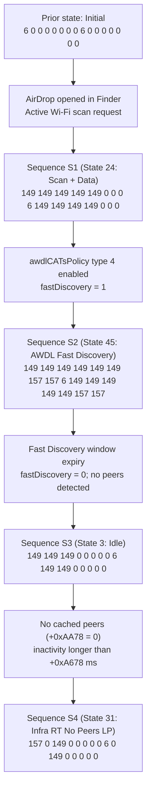

# Explanation of the AWDL sequences observed on real hardware (macOS 26.7.1, 25G241)

Analysis of the macOS 26.7.1 kernelcollection (build 25G241, Darwin 25.6.0, `x86_64`) that determines
the state of the AWDL manager (`IO80211AWDLPeerManager`), the row of the slot-type table
`__ZL20_channelSeqSlotTypes` and the operating conditions producing the four channel sequences
(request `APPLE80211_IOC_AWDL_SYNC_CHANNEL_SEQUENCE`, type 129, 16 slots) registered on
real hardware after opening the AirDrop window in Finder. Complements `Docs/AWDL_SECUENCIA_CON_INFRA.md`,
`Docs/AWDL_CHANNEL_SEQUENCE_CONTROL.md` and `Docs/AWDL_CAP29_DOBLE_BANDA_RIESGOS.md`.

Source: disassembly and decompilation in the annotated kernelcache of build 25G241. All cited
virtual addresses (VA) correspond to instruction heads or static data of that
image. Manager ivar references are taken relative to `*(this+0x20)` (`awdlIvars`) and base object ones relative
to `*(this+0x18)` (`pm`). Anything unverified is marked `?`.

---

## 1. Summary

In the real-hardware tests with capability 29 (dual band) active, the infrastructure
interface associated on 5 GHz (primary channel 157, 80 MHz, block 149–161, flags `0x410`), social
channels 6/149/44, no AWDL peers and no AirPlay sink (`airplaySink == 0`), opening AirDrop generated
four channel sequences in order:

1. **S1**: `149 149 149 149 149   0   0   0   6 149 149 149 149   0   0   0`  
   Produced by state **24 (`Scan + Data`)**, row `0xffffff80023aa7f0` (`3 3 3 3 3 1 1 1 2 4 3 4 4 1 1 1`).
   It activates while a scan is in progress (`pm+0x9A8 != 0`); who requests that scan when opening AirDrop
   was not followed `?`.
2. **S2**: `149 149 149 149 149 149 157 157   6 149 149 149 149 149 157 157`  
   Produced by state **45 (`AWDL Fast Discovery`)**, row `0xffffff80023aad30` (`3 3 3 3 3 3 9 9 2 4 3 4 4 4 9 9`).
   Slots 6, 7, 14 and 15 correspond to **type 9** (not type 7), which resolves to the
   infrastructure channel 157 through `infraAllowedForNonRealtimeCases()` without requiring AirPlay services.
   It activates with `awdlCATsPolicy` notification type 4 enabled (fast discovery); whether the
   request comes from `wifip2pd` was not verified `?`.
3. **S3**: `149 149 149   0   0   0   0   0   6 149 149   0   0   0   0   0`  
   Produced by state **3 (`Idle`)** (or alternatively state **1 `Discovery + Infra Stream`**),
   row `0xffffff80023aa2b0` (`3 3 3 1 1 1 7 7 2 4 3 1 1 1 7 7`).
   Slots 6, 7, 14 and 15 are **type 7**, which evaluate `addInfraToMinimumChannelSequence()`; with no
   AirPlay services registered (`_countAirPlayServices == 0`), they resolve to channel 0.
4. **S4**: `157   0 149   0   0   0   0   0   6   0 149   0   0   0   0   0`  
   Produced by state **31 (`Infra BE RealTime + No Cached Peers + LP`)**, row `0xffffff80023aa9b0`
   (`9 1 3 1 1 1 1 1 2 1 3 1 1 1 1 1`).
   Slot 0 is type 9 (resolving to channel 157), slots 2 and 10 are type 3 (social 149),
   8 is type 2 (social 6) and the remaining 12 are type 1 (channel 0). It indicates the AWDL manager
   enters low-power idle (*Low Power Idle*) when the discovery window is exhausted without finding peers.

Slots 4 and 12 do not resolve to 149 through any dynamic substitution on type 1: in S1 and S2 those
slots are statically tabulated as **type 3** and **type 4**, which load directly the secondary and
current channel (149).

---

## 2. Full slot-type table per state (`__ZL20_channelSeqSlotTypes`)

The static table resides at address `0xffffff80023aa1f0` and contains 56 rows (states 0 to 55),
each composed of 16 32-bit integers (64 bytes per row). The row address computation runs in
`IO80211AWDLPeerManager::setChannelSequenceByState` via `shl rax, 6` at
`0xffffff80021f545c`, followed by the indexed access `lea rcx, __ZL20_channelSeqSlotTypes` at
`0xffffff80021f5475`. The state name literals resolve through the array of string
pointers at `0xffffff8002459c20`. Immediately after row 55 (offset `+0xE00`), at `0xffffff80023aaff0`,
the data structure `__ZL13_channel6Info` begins.

| State | Name in `0xffffff8002459c20` | Row VA | Slots 0..15 (slot type) |
|:---:|:---|:---:|:---|
| 0 | Discovery | `0xffffff80023aa1f0` | ` 3  3  3  3  1  1  7  7  2  4  3  4  1  1  7  7` |
| 1 | Discovery + Infra Stream | `0xffffff80023aa230` | ` 3  3  3  1  1  1  7  7  2  4  3  1  1  1  7  7` |
| 2 | Assisted Discovery | `0xffffff80023aa270` | `10 10 10 10 10 10 11 11 10 10 10 10 10 10 11 11` |
| 3 | Idle | `0xffffff80023aa2b0` | ` 3  3  3  1  1  1  7  7  2  4  3  1  1  1  7  7` |
| 4 | Low Power | `0xffffff80023aa2f0` | ` 9  1  3  1  1  1  7  7  2  7  3  1  1  1  7  7` |
| 5 | Data | `0xffffff80023aa330` | ` 0  0  0  0  0  0  0  0  0  0  0  0  0  0  0  0` |
| 6 | Data + Infra Stream | `0xffffff80023aa370` | ` 3  3  3  3  9  9  6  6  2  4  3  9  9  9  9  9` |
| 7 | Data + Infra Data | `0xffffff80023aa3b0` | ` 3  3  3  3  9  9  6  6  2  4  3  4  9  9  9  9` |
| 8 | Data + Infra Idle | `0xffffff80023aa3f0` | ` 3  3  3  3  3  3  6  6  2  4  3  4  4  4  6  6` |
| 9 | RealTimeData | `0xffffff80023aa430` | ` 0  0  0  0  0  0  0  0  0  0  0  0  0  0  0  0` |
| 10 | RealTimeData + InfraAssist | `0xffffff80023aa470` | ` 9  9  9  9  9  9  9  9  9  9  9  9  9  9  9  9` |
| 11 | RealTimeData + InfraAssist with Social | `0xffffff80023aa4b0` | ` 9  9  3  9  9  9  9  9  9  9  4  9  9  9  9  9` |
| 12 | RealTimeData + Split Infra Legacy | `0xffffff80023aa4f0` | `12 12 12 12  5  5  5  5 12 12 12 12  6  6  6  6` |
| 13 | RealTimeData + Split Infra | `0xffffff80023aa530` | `12 12 12 12  5  5  6  6 12 12 12 12  5  5  6  6` |
| 14 | RealTimeData + Split Infra + Same DFS | `0xffffff80023aa570` | `12  5  5  5  5  5  5  5  5 12  5  5  5  5  5  5` |
| 15 | RealTimeData + Split Infra + Retrogade Legacy | `0xffffff80023aa5b0` | `12 12 12 12  5  5  5  5 12 12 12 12 12 12  1  1` |
| 16 | RealTimeData + Split Infra + Retrogade | `0xffffff80023aa5f0` | `12 12 12 12  5  5  1  1 12 12 12 12 12 12  1  1` |
| 17 | RealTimeData + Split Infra + RetroSDB Legacy | `0xffffff80023aa630` | `12 12 12 12  5  5  5  5 12 12 12 12 12 12  2  2` |
| 18 | RealTimeData + Split Infra + RetroSDB | `0xffffff80023aa670` | `12 12 12 12  5  5  2  2 12 12 12 12 12 12  2  2` |
| 19 | RealTimeData + Favor ATV Infra | `0xffffff80023aa6b0` | ` 5  5 12  5  5  5  5  5  5  5 12  5  5  5  6  6` |
| 20 | RealTimeData + Favor Client Infra Legacy | `0xffffff80023aa6f0` | ` 5  5 12  5  5  5  5  5  5  5 12  5  5  5  6  6` |
| 21 | RealTimeData + Favor Client Infra | `0xffffff80023aa730` | ` 5  5 12  5  5  5  6  6  5  5 12  5  5  5  6  6` |
| 22 | unknown | `0xffffff80023aa770` | ` 3  3  5  5  5  5  5  5  5 12 12  5  5  5  6  6` |
| 23 | IdleAndRealTimeData | `0xffffff80023aa7b0` | ` 3  3  3  1  1  1  8  8  2  4  4  1  1  1  8  8` |
| 24 | Scan + Data | `0xffffff80023aa7f0` | ` 3  3  3  3  3  1  1  1  2  4  3  4  4  1  1  1` |
| 25 | Scan + Data + Infra Data | `0xffffff80023aa830` | ` 3  3  3  9  9  1  1  1  2  4  3  9  9  1  1  1` |
| 26 | Scan + RealtimeData | `0xffffff80023aa870` | `12 12 12 12  5  1  1  1 12 12 12 12  6  1  1  1` |
| 27 | Scan + RealtimeData + InfraAssist | `0xffffff80023aa8b0` | ` 9  9  9  9  5  1  1  1  9  9  9  9  6  1  1  1` |
| 28 | Piggyback Scan + Data | `0xffffff80023aa8f0` | ` 0  0  0  0  0  0  0  0  0  0  0  0  0  0  0  0` |
| 29 | Infra Priority | `0xffffff80023aa930` | ` 9  9  3  1  1  1  1  9  2  9  3  9  1  1  1  9` |
| 30 | Infra BE RealTime + No Cached Peers + Disc | `0xffffff80023aa970` | ` 9  1  3  1  1  3  9  9  2  1  3  1  1  3  9  9` |
| 31 | Infra BE RealTime + No Cached Peers + LP | `0xffffff80023aa9b0` | ` 9  1  3  1  1  1  1  1  2  1  3  1  1  1  1  1` |
| 32 | Forced | `0xffffff80023aa9f0` | ` 0  0  0  0  0  0  0  0  0  0  0  0  0  0  0  0` |
| 33 | Assisted Discovery Multi Channel | `0xffffff80023aaa30` | `10 10 10 10 10 10 11 11 13 13 13 13 13 13 14 14` |
| 34 | Time Sync | `0xffffff80023aaa70` | ` 3  1  3  1  3  1  1  1  3  1  3  1  3  1  1  1` |
| 35 | unknown | `0xffffff80023aaab0` | ` 3  3  3  3  3  3  1  1  3  3  3  3  3  3  1  1` |
| 36 | Time Sync Infra | `0xffffff80023aaaf0` | `15  1  3  1 15  1  1  1 15  1  3  1 15  1  1  1` |
| 37 | unknown | `0xffffff80023aab30` | `15  3  3  3  3  3  1  1  3  3  3  3  3  3  1  1` |
| 38 | Time Sync Retro | `0xffffff80023aab70` | ` 3  1  1  1  3  1  1  1  3  1  1  1  3  1  1  1` |
| 39 | Sidecar Start | `0xffffff80023aabb0` | ` 0  0  0  0  0  0  0  0  0  0  0  0  0  0  0  0` |
| 40 | RtMode Start | `0xffffff80023aabf0` | ` 0  0  0  0  0  0  0  0  0  0  0  0  0  0  0  0` |
| 41 | High Thruput | `0xffffff80023aac30` | ` 4  4  4  4  4  4  4  4  4  4  4  4  4  4  4  4` |
| 42 | Sidecar Single 2.4Channel | `0xffffff80023aac70` | `12 12 12 12  5  5  5  5 12 12 12 12 12 12 12 12` |
| 43 | Ranging | `0xffffff80023aacb0` | ` 4  4  4  4  5  5  5  5  4  4  4  4  5  5  5  5` |
| 44 | RealTimeGroup | `0xffffff80023aacf0` | ` 0  0  0  0  0  0  0  0  0  0  0  0  0  0  0  0` |
| 45 | AWDL Fast Discovery | `0xffffff80023aad30` | ` 3  3  3  3  3  3  9  9  2  4  3  4  4  4  9  9` |
| 46 | ProMode + Infra Idle | `0xffffff80023aad70` | `16 16  3 16 16 16 17 17 16 16  4 16 16 16 17 17` |
| 47 | AWDL Fast Discovery and infra priority | `0xffffff80023aadb0` | ` 3  9  9  3  9  9  3  9  2  3  9  9  3  9  9  9` |
| 48 | AWDL Fast Discovery and infra priority | `0xffffff80023aadf0` | ` 9  9  3  9  9  3  9  9  2  9  3  9  9  3  9  9` |
| 49 | ProMode Scan + Data | `0xffffff80023aae30` | `16 16  3 16 16  1  1  1 16 16  4 16 16  1  1  1` |
| 50 | ProMode Scan + Data + Infra Data | `0xffffff80023aae70` | `16 16  3 19 19  1  1  1 16 16  4 19 19  1  1  1` |
| 51 | ProMode + Infra Stream | `0xffffff80023aaeb0` | `16 16  3 16 19 19 17 17 16 16  4 19 19 19 19 19` |
| 52 | ProMode + Infra Data | `0xffffff80023aaef0` | `16 16  3 16 19 19 17 17 16 16  4 16 19 19 19 19` |
| 53 | Long Discovery | `0xffffff80023aaf30` | ` 3  3  3  3  3  3  7  7  2  4  3  4  3  3  7  7` |
| 54 | Ultra Low Latency Infra | `0xffffff80023aaf70` | `20  9 20  1  1  1  1  9 20 20 20 20  1  1  1  9` |
| 55 | RTG AirDrop | `0xffffff80023aafb0` | ` 0  0  0  0  0  0  0  0  0  0  0  0  0  0  0  0` |

---

## 3. Exact identification of the observed sequences S1–S4

| Sequence | Observed channel sequence | Assigned state | Tabulated row | Operating conditions | Key VAs |
|---|---|:---:|---|---|---|
| **S1** | `149 149 149 149 149 0 0 0 6 149 149 149 149 0 0 0` | **24** (`Scan + Data`) | `3 3 3 3 3 1 1 1 2 4 3 4 4 1 1 1` | Scan active (`pm+2472 != 0`); no ProMode (`+65432 == 0`). Types 3 and 4 resolve to 149; type 2 to 6; type 1 to channel 0. | `0xffffff80022198bc` `0xffffff80022198c5` `0xffffff80023aa7f0` `0xffffff80021f549a` |
| **S2** | `149 149 149 149 149 149 157 157 6 149 149 149 149 149 157 157` | **45** (`AWDL Fast Discovery`) | `3 3 3 3 3 3 9 9 2 4 3 4 4 4 9 9` | `fastDiscovery == 1` (`+65193`); `infraAllowedForNonRealtimeCases()` true; type 9 resolves to infra 157 without requiring AirPlay services. | `0xffffff80021ff051` `0xffffff80021ff073` `0xffffff80021d456b` `0xffffff80023aad30` `0xffffff80021f568e` |
| **S3** | `149 149 149 0 0 0 0 0 6 149 149 0 0 0 0 0` | **3** (`Idle`) or **1** (`Disc+Infra`) | `3 3 3 1 1 1 7 7 2 4 3 1 1 1 7 7` | Fast Discovery ceases (`+65193 = 0`); no AWDL peers; no AirPlay services (`_countAirPlayServices == 0`); type 7 evaluates false and falls to channel 0. | `0xffffff80021f1bb6` `0xffffff80023aa2b0` `0xffffff80021f56ed` `0xffffff80021f5ef6` |
| **S4** | `157 0 149 0 0 0 0 0 6 0 149 0 0 0 0 0` | **31** (`Infra BE RT + No Cached Peers + LP`) | `9 1 3 1 1 1 1 1 2 1 3 1 1 1 1 1` | `+0x3ED0 == 1`; no cached peers (`+0xAA78 == 0`); no activity for `+0xA678` ms (threshold against `+0xA5E8` and `+0xA5D8`); slot 0 (type 9) resolves to infra 157; slots 2 and 10 to 149; 8 to 6; rest to 0. | `0xffffff80021d4504` `0xffffff80023aa9b0` `0xffffff80021f568e` `0xffffff80021f549a` |

---

## 4. Slot-type resolution to channel (`0..20`)

The function `IO80211AWDLPeerManager::setChannelSequenceByState` (`0xffffff80021f53aa`) implements a
16-iteration loop (`rbx` advances in 12-byte steps from `0` to `0xC0`, `0xffffff80021f5464`
to `0xffffff80021f5bf0`). Each iteration loads the dword type from the table (`0xffffff80021f547c`)
and jumps through an indirect table of 21 entries (`0xffffff80021f5e90`, jump at `0xffffff80021f5498`).
At the end of each slot a 6 GHz guard runs (`0xffffff80021f5b82`) that substitutes the channel
if it is not authorized.

Below is the resolution of each type (0..20) with its provenance fields and gates:

### Type 0: Do not modify slot
- **VA**: `0xffffff80021f5b7e`
- **Source**: Performs no write to `awdlIvars + 0xA774 + slot*12`. Keeps the previous value verbatim.
- **Use**: States preserving learned or externally fixed sequences (states 5, 9, 28, 32, 39, 40, 44, 55).

### Type 1: Unserved slot (channel 0)
- **VA**: `0xffffff80021f549a`
- **Source**: Writes `dword_FFFFFF8002488A90` (value 0) to `+0xA77C` (`0xffffff80021f54a4`) and copies the constant
  `__ZL13_zeroChanInfo` (`0xffffff8002488a88` = `{version: 1, channel: 0}`) to `+0xA774` (`0xffffff80021f54ab`,
  store at `0xffffff80021f5b76`).
- **Behavior**: Resolves **always and unconditionally to channel 0**. No route exists in the
  disassembly replacing the channel of a type-1 slot with a social or infrastructure channel.
- **Clarification on S1 and S2**: Channel 149 in slots 4 and 12 of sequences S1 and S2 is not due
  to a substitution of type 1, but to the fact that in states 24 and 45 those slots **are not type 1**:
  in state 24 slot 4 is **type 3** and slot 12 is **type 4**; in state 45 slot 4 is **type 3**
  and 12 is **type 4**.

### Type 2: Primary master info (primary social channel)
- **VA**: `0xffffff80021f5b5e`
- **Source**: Reads flags from `awdlIvars + 0x42A8` (`0xffffff80021f5b62`) and `{version, channel}` from
  `awdlIvars + 0x42A0` (`0xffffff80021f5b6f`).
- **Result in the scenario**: `{1, 6, 0x8}` (channel 6, 2.4 GHz at 20 MHz).

### Type 3: Secondary or primary master info
- **VA**: `0xffffff80021f56e4` (jump to `0xffffff80021f58d2`)
- **Source**: Checks `awdlIvars + 0x42B0` (secondary channel) at `0xffffff80021f58d2`.
  - If `+0x42B0 != 0`: takes `{version, channel}` from `awdlIvars + 0x42AC` and flags from `+0x42B4` (`0xffffff80021f58df`).
  - If `+0x42B0 == 0`: falls back to the primary master `awdlIvars + 0x42A0` (`0xffffff80021f5a4e`).
- **Result in the scenario**: With capability 29 active, `+0x42B0 == 149`, so it resolves to `{1, 149, 0x10}`.

### Type 4: Current AWDL channel
- **VA**: `0xffffff80021f5654`
- **Source**: Reads flags from `awdlIvars + 0x1A8` (`0xffffff80021f5658`) and `{version, channel}` from
  `awdlIvars + 0x1A0` (`0xffffff80021f5665`).
- **Result in the scenario**: Initialized by `selectChannelsToUseForAWDL` (`0xffffff80021dc2f2`) with the
  secondary's value `{1, 149, 0x10}`.

### Type 5: Real-time channel / RT peer
- **VA**: `0xffffff80021f5785`
- **Source**: Reads flags from `awdlIvars + 0x42C0` (`0xffffff80021f5789`) and `{version, channel}` from
  `awdlIvars + 0x42B8` (`0xffffff80021f5796`).

### Type 6: Auxiliary channel / secondary DFS
- **VA**: `0xffffff80021f588f`
- **Source**: Reads flags from `awdlIvars + 0x42CC` (`0xffffff80021f5893`) and `{version, channel}` from
  `awdlIvars + 0x42C4` (`0xffffff80021f58a0`).

### Type 7: Infrastructure with AirPlay gate
- **VA**: `0xffffff80021f56ed`
- **Source**: Invokes `IO80211AWDLPeerManager::addInfraToMinimumChannelSequence` at `0xffffff80021f56f0`.
  - If it returns `true`: loads `{version, channel}` from `pm + 0x9BC` (`pm + 2492`) and flags from `pm + 0x9C4`
    (`pm + 2500`) at `0xffffff80021f5707`–`0xffffff80021f571b`.
  - If it returns `false`: loads `__ZL13_zeroChanInfo` and `dword_FFFFFF8002488A90` (channel 0) at `0xffffff80021f56f5`.
- **Internal condition of `addInfraToMinimumChannelSequence`** (`0xffffff80021f5ef6`):
  Requires the conjunction of:
  1. `infraAllowedForNonRealtimeCases()` != 0 (`0xffffff80021f5f57`).
  2. Infra flags without bit `0x2000` (not 6 GHz) at `0xffffff80021f5f4d`.
  3. **AirPlay services count > 0**: `IO80211CommandQueue::lockMap` with callback `_countAirPlayServices`
     (`0xffffff80021f5f1e`). Without `"airplay"`/`"raop"` services, it returns 0 unconditionally.

### Type 8: Infrastructure with AirPlay Sink gate
- **VA**: `0xffffff80021f592c`
- **Source**: Checks `awdlIvars + 0xA648` (`airplaySink`) at `0xffffff80021f5930`.
  - If `+0xA648 != 0`: copies infra channel and flags from `pm + 0x9BC`/`0x9C4` (`0xffffff80021f5947`).
  - If `+0xA648 == 0`: writes channel 0 (`_zeroChanInfo`, `0xffffff80021f5937`).

### Type 9: Infrastructure allowed without AirPlay services gate
- **VA**: `0xffffff80021f568e`
- **Source**: Invokes `IO80211AWDLPeerManager::infraAllowedForNonRealtimeCases` at `0xffffff80021f5691`.
  - **Positive branch** (`0xffffff80021f569e`): Copies **directly** `{version, channel}` from `pm + 0x9BC`
    (`0xffffff80021f56a6`) and flags from `pm + 0x9C4` (`0xffffff80021f56ad`). **Does not consult AirPlay**.
    In the scenario with infra associated on 157 (`0x410`), non-DFS, this condition is true and writes
    `{1, 157, 0x410}`.
  - **Negative branch** (`0xffffff80021f5a5a`):
    - If it is **slot 0** (`rbx == 0`, `0xffffff80021f5a61`): evaluates `awdlIvars + 0x3ED9` (infra allowed) at
      `0xffffff80021f5dc8`. If active and `pm + 0x9BC != 0`, **it also copies the infrastructure channel**
      at `0xffffff80021f5e75`; if not, it writes channel 6 with flags `0xA` at `0xffffff80021f5df5`.
    - If they are **slots 1..15** (`rbx != 0`): evaluates whether `fastDiscovery` (`awdlIvars + 0xFEA9`), the state and SDB
      are active (`0xffffff80021f5a67`–`0xffffff80021f5a9f`); if so, it writes channel 6; if not, channel 0.

### Type 10: Primary assisted discovery
- **VA**: `0xffffff80021f58eb`
- **Source**: Assisted channel `awdlIvars + 0xFA0C`/`+0xFA08` (`0xffffff80021f58f4`). If 0, falls back to
  secondary `+0x42AC` or primary `+0x42A0` (`0xffffff80021f58fd`–`0xffffff80021f590b`).

### Type 11: Secondary assisted discovery
- **VA**: `0xffffff80021f559c`
- **Source**: Evaluates timestamps `awdlIvars + 0xFA28` and `+0xFA30` against `mach_absolute_time()` (1000 ms
  window, `0xffffff80021f55de`, `0xffffff80021f5624`). Selects assisted channel `+0xFA08` or infra channel
  `pm + 0x9BC` (`0xffffff80021f5641`, `0xffffff80021f5da4`).

### Type 12: RT Legacy channel
- **VA**: `0xffffff80021f5671`
- **Source**: Flags from `awdlIvars + 0x1C0` (`0xffffff80021f5675`) and channel from `awdlIvars + 0x1B8` (`0xffffff80021f5682`).

### Type 13: Primary multichannel assisted discovery
- **VA**: `0xffffff80021f57c9`
- **Source**: Structure `awdlIvars + 0xFA08` or secondary/primary with peer support (`0xffffff80021f57ee`–`0xffffff80021f583e`).

### Type 14: Secondary multichannel assisted discovery
- **VA**: `0xffffff80021f54e5`
- **Source**: Structure `awdlIvars + 0xFA14` or timers at `+0xFA28`/`+0xFA30` (`0xffffff80021f5519`–`0xffffff80021f5584`).

### Type 15: Alternative RT channel
- **VA**: `0xffffff80021f56c7`
- **Source**: Flags from `awdlIvars + 0x1CC` (`0xffffff80021f56cb`) and channel from `awdlIvars + 0x1C4` (`0xffffff80021f56d8`).

### Type 16: ProMode channel
- **VA**: `0xffffff80021f54b7`
- **Source**: Checks `awdlIvars + 0xFF80` (`0xffffff80021f54bb`). If active, reads `+0xFF7C`/`+0xFF84`
  (`0xffffff80021f54d0`); if not, reads current channel `+0x1A0`/`+0x1A8` (`0xffffff80021f5ca9`).

### Type 17: ProMode with idle Infra
- **VA**: `0xffffff80021f5736`
- **Source**: Infra channel `pm + 0x9BC` if 5 GHz and SDB active (`0xffffff80021f573a`–`0xffffff80021f5745`);
  otherwise `+0xFF7C` or `+0x42C4` (`0xffffff80021f5af9`).

### Type 18: ProMode with social support
- **VA**: `0xffffff80021f58ac`
- **Source**: If `+0xFF80 != 0`, loads `+0xFF7C`/`+0xFF84` (`0xffffff80021f58b9`); if not, falls back to
  secondary `+0x42AC` or primary `+0x42A0` (`0xffffff80021f58df`).

### Type 19: ProMode with infrastructure data
- **VA**: `0xffffff80021f5972`
- **Source**: Evaluates SDB (`0xffffff80021f5989`) and `infraAllowedForNonRealtimeCases()` (`0xffffff80021f59c1`, `0xffffff80021f5c05`).
  If allowed, loads the infrastructure channel `pm + 0x9BC` (`0xffffff80021f5c1d`); if not, channel 6 or 0.

### Type 20: Ultra low latency infrastructure
- **VA**: `0xffffff80021f5768`
- **Source**: Secondary channel `awdlIvars + 0x42AC` (`0xffffff80021f5779`) or primary `+0x42A0` (`0xffffff80021f5b0f`).
  If SDB is active and infra is on 2.4 GHz, switches to primary `+0x42A0` (`0xffffff80021f5b48`–`0xffffff80021f5b5e`).

---

## 5. Transition dynamics between S1, S2, S3 and S4

The order of appearance of the sequences after opening Finder AirDrop responds to a precise
sequence of userspace events (`wifip2pd`), controller scans and inactivity timers:

### 5.1 Transition to S1: Initial scan
- Opening the AirDrop window shows a scan; which process requests it was not followed `?`.
- In the kernel, `IO80211AWDLPeerManager::setScanningState` (`0xffffff800221924e`) detects the scan counter
  is non-null (`pm + 2472 != 0`, `0xffffff80022192cb`) and there is no active ProMode session (`+65432 == 0`).
- It loads state 24 (`mov esi, 18h` at `0xffffff80022198bc`, reason 0) and calls `setScheduleState` at
  `0xffffff80022198c5`, a call it shares with the state 5 request of `0xffffff80022198ad`. The call at
  `0xffffff80022197ce` is a different one: it requests state 5 with reason 1.
- The state machine adopts state **24 (`Scan + Data`)**, whose static row at `0xffffff80023aa7f0`
  produces exactly **S1**.

### 5.2 Transition to S2: Fast Discovery
- `IO80211AWDLPeerManager::awdlCATsPolicy` (`0xffffff80021fed66`) receives notification type 4 enabled
  (case 4 of the `switch`). That `wifip2pd` requests it and with which ioctl was not verified `?`.
- The function sets the `fastDiscovery` flag by writing `1` to `awdlIvars + 65193` (`0xFEA9`) at
  `0xffffff80021ff051`, saves the timestamp at `+65200` (`0xFEB0`, `0xffffff80021ff061`), loads state 45
  and reason 39 (`0xffffff80021ff073`, `0xffffff80021ff078`) and jumps to the shared call at
  `0xffffff80021ff3cc`, the same one the deactivation with (5, 40) uses.
- When a later request reaches `setScheduleState` with `fastDiscovery` active (test at
  `0xffffff80021d337b`), while the threshold of `+0x3E98` ms since `+0xFEB0` has not expired (or the one of `+0x3E94` ms since
  `+0xA5E8` and `+0xA5D8`), the function forces state **45** at `0xffffff80021d456b`, with the log
  `"Force FastDiscovery mode: fastDiscovery: %u"`. If already at 45, it only logs
  `"Already in FastDiscovery mode"`. The other branch logging "Force FastDiscovery", the one testing
  `+0x3ED9` at `0xffffff80021d3467`, chooses states 48 (infra allowed) or 47, not 45.
- In state 45, the static row at `0xffffff80023aad30` assigns type 9 to slots 6, 7, 14 and 15. Since
  the infrastructure is associated on 157 (non-DFS) and authorized (`+0x3ED9 == 1`), `infraAllowedForNonRealtimeCases()`
  evaluates true at `0xffffff80021f5696`, loading 157 into those 4 slots and producing **S2**.

### 5.3 Transition to S3: Fast Discovery ceases and moves to idle
- The fast discovery burst has a bounded duration. On expiry or cancellation, `awdlCATsPolicy`
  is invoked with type 4 disabled, clears the flag `+65193 = 0` at `0xffffff80021ff3a0` and requests
  `setScheduleState(5, 40, true)` at `0xffffff80021ff3cc`.
- The step to state 3 is requested, among others, by `setIdleMode` (`0xffffff80021f1bb6`) and case 5 of `awdlCATsPolicy`
  (`0xffffff80021ff421`, reason 0x0C). `discoveryTimeout` (`0xffffff80021c3e56`) does not request the 3: it re-requests the
  current state (`+0x28E4`, reason 0x2E, call at `0xffffff80021c3e75`). Which caller acted in the
  test is not known `?`.
- The machine adopts state **3 (`Idle`)** (or state 1), whose row at `0xffffff80023aa2b0` assigns
  **type 7** to slots 6, 7, 14 and 15.
- The resolution function invokes `addInfraToMinimumChannelSequence()` at `0xffffff80021f56f0`. With no
  AirPlay service registered in the command queue (`0xffffff80021f5f69`), the function returns `0`.
- As a consequence, the type-7 slots load `_zeroChanInfo` (channel 0), resulting exactly in **S3**.

### 5.4 Transition to S4: Deep idle without peers (Low Power)
- If the interface stays idle without detecting any AWDL peer in its neighborhood, the peer counter
  stored at `awdlIvars + 43640` (`+0xAA78`) stays at 0.
- Inside `setScheduleState`, with `awdlIvars + 0x3ED0 == 1`, `+0xAA78 == 0` and the elapsed time since
  `+0xA5E8` and since `+0xA5D8` equal to or greater than the threshold `+0xA678` (`42616`, ms), the function **rewrites the
  target state** to 31 (`mov r13d, 1Fh` at `0xffffff80021d4504`) after the log
  `"... change to kAwdlScheduleStateInfraRealTimeNoCachedPeersLowPower"`. Which requested states admit that
  rewrite was not enumerated `?`.
- In state 31, the row at `0xffffff80023aa9b0` contains:
  - **Slot 0**: type 9. On slot 0, `infraAllowedForNonRealtimeCases()` (or the slot-0 fallback path at
    `0xffffff80021f5dc8` with `+0x3ED9 == 1`) copies the infrastructure channel `pm + 0x9BC` (157).
  - **Slots 2 and 10**: type 3, which resolves to 149.
  - **Slot 8**: type 2, which resolves to the primary social 6.
  - **Slots 1, 3, 4, 5, 6, 7, 9, 11, 12, 13, 14, 15**: type 1, which resolves unconditionally to channel 0.
- The result is exactly **S4**, confirming the AWDL manager has moved to its idle and energy-saving
  mode in the presence of an infrastructure link.

---

## 6. Driver obligations per slot type and verdict on S4

### 6.1 What the driver must execute per slot type for an iPhone to discover the Mac

For a nearby iPhone to discover the Mac in the AirDrop UI, the driver must coordinate
its actions according to the slot type present in the sequence received through ioctl 129:

1. **Social slots (Types 2, 3 and 4)**:
   - **Radio tuning**: The radio must be tuned to the corresponding channel (channel 149 on 5 GHz
     for types 3 and 4; channel 6 on 2.4 GHz for type 2). If the radio does not switch channels dynamically, it must
     stay parked on channel 149 (`rtlawdl_ch=149`).
   - **Sync and action frame emission**: In each availability window of these slots, the
     driver must transmit the Master Indication Frame (MIF) / Periodic Synchronization Frame (PSF)
     using the template provided by the kernel (`buildMasterIndicationTemplate`, `0xffffff8002211b42`),
     addressed to the AWDL broadcast address `00:25:00:FF:94:73`, including the AirDrop and sync TLVs.
   - **Reception and delivery**: It must keep the receiver open for 20 MHz AWDL action frames. On receiving
     a frame from an iPhone, the driver must deliver it to the manager through the `bpfTapInput` route (dlt 12) that ends in
     `IO80211AWDLPeerManager::actionFrameProcessInput` (`0xffffff800220e8b0`, `AWDL_AF_TO_DAEMON.md`). This causes the kernel to instantiate
     the corresponding `IO80211AWDLPeer` object, adopt the peer's sequence (`followPeerChannelSequence`) and
     establish the data link.
   - **Timer event generation**: The driver must periodically emit events 41 and 43 to the kernel
     during the active social slots to keep slot clock synchronization.

2. **Infrastructure slots (Types 7 and 9)**:
   - In this scenario they resolve to primary channel 157 (80 MHz, flags `0x410`).
   - The driver must serve the data traffic and beacons of the access point (infrastructure BSS on `en2`).
   - Since the band (5 GHz) and the 80 MHz block (149–161, center 155) match, a radio with
     agile primary switching capability or wide channel support can alternate between 149 and 157 without restarting the
     RF block.
   - On these slots the iPhone will not look for AWDL discovery frames unless it is associated with the same BSS.

3. **Unserved slots (Type 1, or Type 7 evaluating to 0)**:
   - The driver must advertise channel 0 in the TLV 18 emitted on the air for those slots.
   - It lets the radio devote that time entirely to the infrastructure link or enter low power
     mode without penalizing the AWDL presence other peers expect.

### 6.2 Meaning of sequence S4: low-power idle

Sequence **S4 unambiguously confirms AWDL is going to idle**:
- It corresponds uniquely to the internal state `kAwdlScheduleStateInfraRealTimeNoCachedPeersLowPower` (state 31).
- The AWDL manager enters this state when:
  1. There is no peer in the discovery table (`+43640 == 0`).
  2. The active discovery burst started by Finder has expired.
  3. An active infrastructure connection exists (`pm + 0x9BC != 0`).
- Its design reduces the social channel presence from 7 slots (in S3) or 10 slots (in S2) to **only 3 slots
  per 16-cycle** (slot 8 on channel 6; slots 2 and 10 on channel 149). Slot 0 is reserved for
  infrastructure (channel 157) and the other 12 slots are declared channel 0 (unserved).
- This minimizes the impact on the infrastructure's network traffic and energy consumption while no
  Apple device nearby tries to communicate over AirDrop.

---

## 7. Open points

1. **Persistence of the return timer from S4 to Fast Discovery on new activity**:
   Exact route by which receiving a BLE frame or a new userspace ioctl from `wifip2pd`
   wakes `IO80211AWDLPeerManager` from state 31 to state 45 `?`.
2. **Effect of NAN/Wi-Fi Aware concurrency on the table**:
   At `0xffffff80021f53d3` and `0xffffff80021f53dc`, the manager evaluates whether NAN is forcing a
   concurrent sequence (`P2P-Concur`). In this configuration NAN is inactive per card capability; it has not been
   evaluated on hardware whether the presence of an iPhone with NAN active modifies slots 5 to 7 `?`.
3. **Mechanism of 149 ↔ 157 primary switching without power reload on the RTL8814AU**:
   Measuring on hardware the intra-block switching time (149 to 157 within 80 MHz,
   center 155) is still pending to verify whether it stays under 2 ms sustainably `?`.

---

## 8. Verification of claims with VAs

Addresses of the macOS 26.7.1 (25G241) kernelcollection supporting the document. Code
ones are instruction heads; table ones are data (start of each 64 B row). Rows 0, 1, 3,
24, 31, 45 and 53, the 21-case bias-free `switch` (`lowcase` 0, table at `0xffffff80021f5e90`) and the
transitions of §5 were checked in the disassembly.

- Static slot-type table: `0xffffff80023aa1f0`
- Jump and table indexing logic: `0xffffff80021f545c`, `0xffffff80021f5475`, `0xffffff80021f5480`, `0xffffff80021f548a`, `0xffffff80021f5498`
- State rows:
  - State 0 (Discovery): `0xffffff80023aa1f0`
  - State 1 (Discovery + Infra Stream): `0xffffff80023aa230`
  - State 3 (Idle): `0xffffff80023aa2b0`
  - State 24 (Scan + Data): `0xffffff80023aa7f0`
  - State 31 (Infra BE RT + No Cached Peers LP): `0xffffff80023aa9b0`
  - State 45 (AWDL Fast Discovery): `0xffffff80023aad30`
  - State 53 (Long Discovery): `0xffffff80023aaf30`
- `_channel6Info` structure: `0xffffff80023aaff0`
- `_zeroChanInfo` structure: `0xffffff8002488a88`, `dword_FFFFFF8002488A90`
- State names: array `0xffffff8002459c20`, literal string `"unknown"` at `0xffffff80023c6e38`
- Slot-type dispatch in `setChannelSequenceByState`:
  - Type 0: `0xffffff80021f5b7e`
  - Type 1: `0xffffff80021f549a`, `0xffffff80021f54a4`, `0xffffff80021f54ab`, `0xffffff80021f5b76`
  - Type 2: `0xffffff80021f5b5e`, `0xffffff80021f5b62`, `0xffffff80021f5b6f`
  - Type 3: `0xffffff80021f56e4`, `0xffffff80021f58d2`, `0xffffff80021f58df`, `0xffffff80021f5a4e`
  - Type 4: `0xffffff80021f5654`, `0xffffff80021f5658`, `0xffffff80021f5665`
  - Type 7: `0xffffff80021f56ed`, `0xffffff80021f56f0`, `0xffffff80021f5707`, `0xffffff80021f5ef6`
  - Type 8: `0xffffff80021f592c`, `0xffffff80021f5930`, `0xffffff80021f5947`
  - Type 9: `0xffffff80021f568e`, `0xffffff80021f5691`, `0xffffff80021f56a6`, `0xffffff80021f5a5a`, `0xffffff80021f5dc8`, `0xffffff80021f5e75`
- 6 GHz guard: `0xffffff80021f5b82`, `0xffffff80021f5b9f`
- Transitions and events:
  - Scan to state 24: `0xffffff80022198bc` (loads 0x18), call at `0xffffff80022198c5`; state 5 with reason 1 at `0xffffff80022197ce`
  - Fast Discovery activation (`+65193 = 1`): `0xffffff80021ff051`, `0xffffff80021ff061`, state 45 and reason 39 at `0xffffff80021ff073`/`0xffffff80021ff078`, shared call at `0xffffff80021ff3cc`
  - Fast Discovery deactivation (`+65193 = 0`): `0xffffff80021ff3a0`, state 5 and reason 40 in the same call `0xffffff80021ff3cc`
  - State 3: `setIdleMode` at `0xffffff80021f1bb6`; case 5 of `awdlCATsPolicy` at `0xffffff80021ff421`
  - Fast Discovery check in `setScheduleState`: `0xffffff80021d337b`, forcing state 45 at `0xffffff80021d456b`; 47/48 branch at `0xffffff80021d3467`
  - Rewrite to state 31: `0xffffff80021d4504`
  - Infrastructure and AirPlay gates: `infraAllowedForNonRealtimeCases` (`0xffffff80021dc540`), `0xffffff80021f5f1e`
